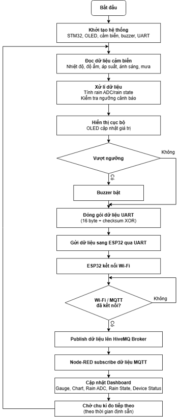
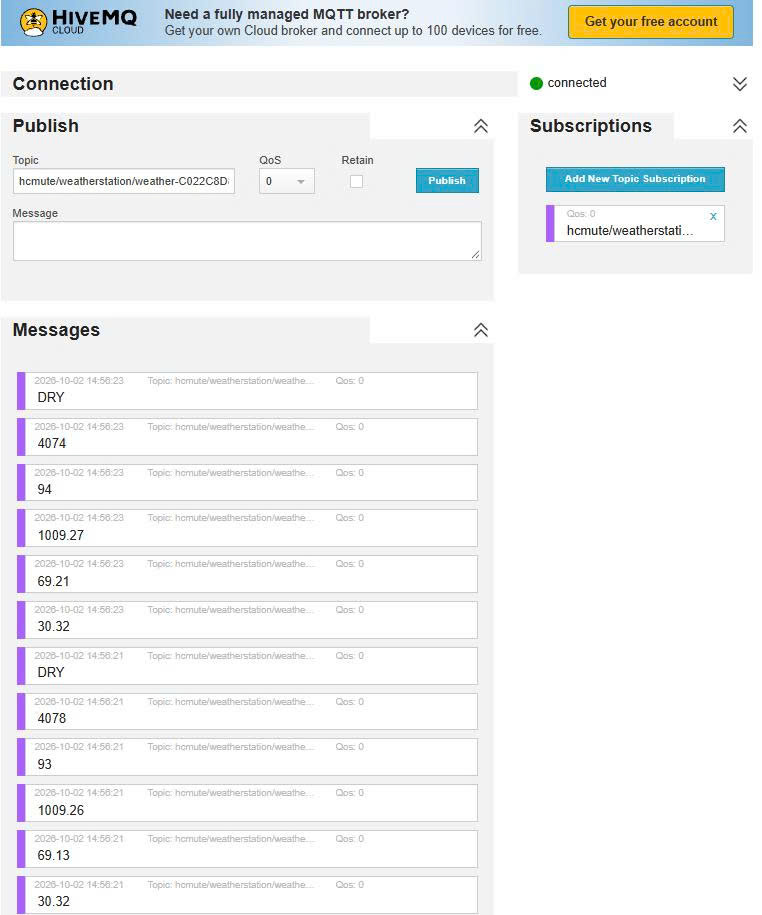
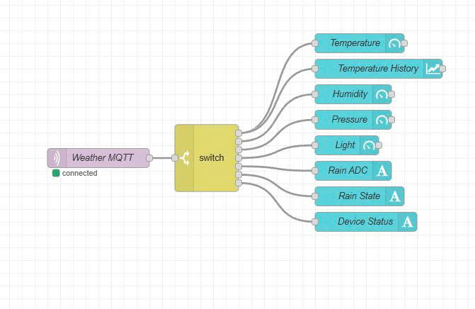
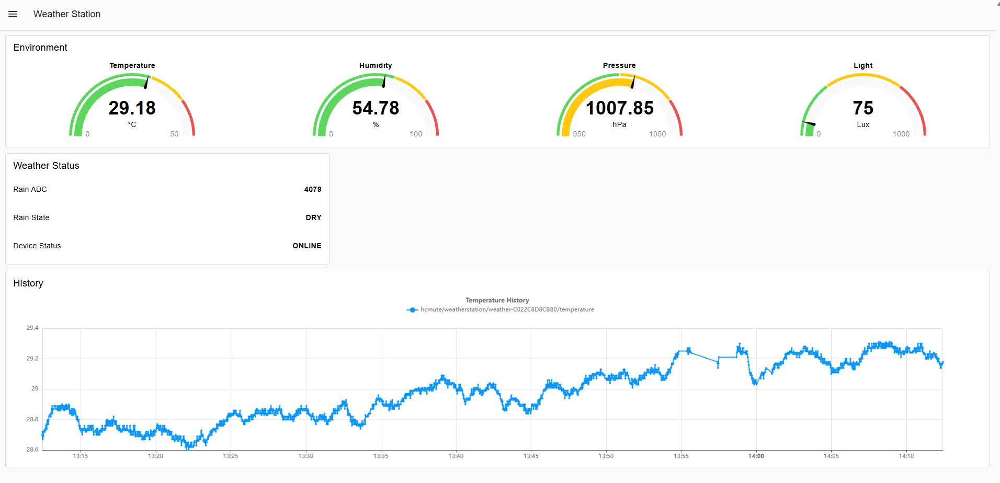

# STM32 IoT Weather Station

**An STM32F103C8T6-based IoT weather monitoring system with ESP32, environmental sensors, MQTT, HiveMQ, and Node-RED Dashboard.**

This project implements a complete embedded weather monitoring system using **STM32F103C8T6** as the main controller and **ESP32** as the Wi-Fi/MQTT communication gateway.

The system collects environmental data, displays measurements locally on an OLED, detects rain conditions, activates buzzer warnings, and publishes sensor information to a Node-RED Dashboard for remote monitoring.

---

## 1. Demo Video

The complete system demonstration is available on YouTube.

**[Watch STM32 IoT Weather Station Demo](https://www.youtube.com/shorts/hM9UjBw_m40)**

YouTube URL:

https://www.youtube.com/shorts/hM9UjBw_m40

The demonstration covers sensor readings, OLED monitoring, rain detection, buzzer alerts, UART communication between STM32 and ESP32, Wi-Fi connectivity, MQTT publishing, and dashboard visualization.

---

## 2. System Overview

The weather station uses two microcontrollers with separate responsibilities.

**STM32F103C8T6 (Main Controller)**

- Reads temperature and humidity from SHT30.
- Reads atmospheric pressure from BMP388.
- Reads light intensity from BH1750.
- Measures rain sensor output through ADC.
- Processes environmental data.
- Classifies rain conditions.
- Updates the OLED display.
- Controls buzzer warnings.
- Transmits weather information to ESP32 through UART.

**ESP32 (Communication Gateway)**

- Receives processed weather data from STM32.
- Connects to a Wi-Fi network.
- Connects to the MQTT broker.
- Publishes environmental measurements.
- Monitors communication status.
- Automatically reconnects after connection loss.

The data is transmitted through the public HiveMQ MQTT broker to Node-RED for visualization.

### System Flowchart

### Overall Data Flow

SHT30 / BMP388 / BH1750 / Rain Sensor → STM32F103C8T6 → UART → ESP32 → Wi-Fi → HiveMQ MQTT Broker → Node-RED → Dashboard

The STM32 also provides local OLED visualization and buzzer control, independently of the Internet connection.

---

## 3. Hardware Components

The main components used in the project are:

| Component | Function |
|---|---|
| STM32F103C8T6 | Main embedded controller |
| ESP32 DevKit | Wi-Fi and MQTT communication gateway |
| SHT30 | Temperature and humidity sensor |
| BMP388 | Atmospheric pressure sensor |
| BH1750 | Ambient light sensor |
| Rain Sensor | Rain detection using analog measurements |
| OLED Display | Local environmental monitoring |
| Active Buzzer | Audible rain warning |
| Breadboard and Wiring | Hardware prototyping and interconnection |

### Hardware Prototype

The complete hardware prototype integrates the STM32, ESP32, environmental sensors, rain sensor, OLED, and buzzer.

---

## 4. Main Features

The implemented system supports:

- Real-time temperature monitoring.
- Real-time humidity monitoring.
- Atmospheric pressure monitoring.
- Ambient light monitoring.
- Rain sensor ADC measurement.
- Rain condition classification: DRY, LOW, and HEAVY.
- OLED display of environmental measurements.
- Local buzzer warnings.
- STM32-to-ESP32 UART communication.
- Wi-Fi connectivity.
- MQTT communication through HiveMQ.
- Node-RED data processing.
- Real-time environmental dashboard.
- Temperature history chart.
- Wi-Fi reconnection.
- MQTT reconnection.
- Automatic recovery after power restart.

---

## 5. Sensor Data Acquisition

The STM32 collects environmental measurements through I2C and ADC interfaces.

### 5.1 SHT30 Temperature and Humidity Sensor

The SHT30 is used to measure:

- Temperature in degrees Celsius (°C).
- Relative humidity in percent (%RH).

The measurements are processed by the STM32 and transmitted to the communication gateway.

### 5.2 BMP388 Atmospheric Pressure Sensor

The BMP388 measures atmospheric pressure.

The pressure value is displayed in hectopascals (hPa).

### 5.3 BH1750 Ambient Light Sensor

The BH1750 measures ambient light intensity.

The measurement is expressed in lux (lx).

### 5.4 Rain Sensor

The rain sensor provides an analog signal that is measured using the STM32 ADC.

The ADC reading is used to determine the current rain condition.

---

## 6. Rain Detection and Classification

The rain monitoring algorithm uses two threshold values:

- `RAIN_DRY_THRESHOLD = 3000`
- `RAIN_HEAVY_THRESHOLD = 1500`

The rain state is determined using the following conditions:

| ADC Reading | Rain State |
|---|---|
| ADC ≥ 3000 | DRY |
| 1500 ≤ ADC < 3000 | LOW |
| ADC < 1500 | HEAVY |

### Classification Logic

When the ADC reading is greater than or equal to 3000, the weather station identifies a dry condition.

When the ADC reading is between 1500 and 2999, the system identifies a low rain condition.

When the ADC reading is below 1500, the system identifies a heavy rain condition.

These thresholds were selected for the project's rain sensor implementation and can be adjusted after calibration.

---

## 7. Buzzer Warning System

The active buzzer provides local warnings according to the detected rain condition.

| Rain State | Buzzer Operation |
|---|---|
| DRY | OFF |
| LOW | Short 150 ms warning beep |
| HEAVY | Continuously ON |

The buzzer is controlled by STM32 GPIO PB0 using active-low logic.

This feature operates locally and does not depend on Wi-Fi or MQTT connectivity.

---

## 8. OLED Display

The OLED provides direct monitoring of the weather station without requiring a computer or network connection.

It displays:

- Temperature.
- Humidity.
- Atmospheric pressure.
- Ambient light intensity.
- Rain ADC reading.
- Rain condition.

### Actual OLED Display

The display is updated with the sensor values processed by the STM32.

---

## 9. STM32 Firmware

The STM32 firmware is developed using STM32 HAL.

### Development Environment

- STM32CubeMX.
- Keil MDK-ARM.
- STM32 HAL Driver.
- ST-Link programmer/debugger.

### Communication Interfaces

| Interface | Configuration | Purpose |
|---|---|---|
| I2C1 | 100 kHz | Environmental sensor communication |
| ADC1 | Channel 0 | Rain sensor input |
| USART1 | 115200 baud, 8N1 | STM32-to-ESP32 communication |
| GPIO PB0 | Digital Output | Buzzer control |
| GPIO PC13 | Digital Output | Heartbeat LED |

### Firmware Organization

The `STM32/` directory contains:

- `Core/Inc/`: Application and sensor header files.
- `Core/Src/`: Application and sensor source files.
- `Drivers/`: STM32 HAL and CMSIS dependencies.
- `MDK-ARM/`: Keil project configuration.
- `WeatherStation.ioc`: STM32CubeMX configuration.

The application includes separate driver modules for SHT30, BMP388, BH1750, the rain sensor, and UART weather data transmission.

---

## 10. STM32-to-ESP32 UART Communication

The STM32 sends processed environmental data to the ESP32 over a UART connection.

### UART Configuration

| Parameter | Value |
|---|---|
| Baud Rate | 115200 |
| Data Bits | 8 |
| Parity | None |
| Stop Bits | 1 |

The transmitted data includes:

- Temperature.
- Humidity.
- Atmospheric pressure.
- Light intensity.
- Rain ADC.
- Rain state.

The ESP32 acts as the communication gateway and forwards this information to the MQTT broker.

---

## 11. ESP32 Wi-Fi and MQTT Gateway

The ESP32 receives the weather measurements from the STM32 and publishes the data to the Internet.

### Development Environment

- Visual Studio Code.
- PlatformIO.
- Arduino Framework.

### ESP32 Responsibilities

1. Initialize UART communication.
2. Connect to the configured Wi-Fi network.
3. Establish a connection to the MQTT broker.
4. Receive data transmitted from the STM32.
5. Publish environmental measurements through MQTT.
6. Monitor connection status.
7. Reconnect automatically if communication is interrupted.

### Actual ESP32 Serial Monitor

The serial output confirms UART initialization, Wi-Fi connection, MQTT connection, sensor data reception, and successful publishing.

---

## 12. MQTT Communication

The project uses the public HiveMQ MQTT broker.

**MQTT Broker:** `broker.hivemq.com`

### Topic Namespace

The weather station uses the following MQTT topic root:

`hcmute/weatherstation/weather-<DEVICE_ID>`

The device identifier distinguishes the weather station from other MQTT clients.

The Node-RED application subscribes to the topic namespace using the MQTT wildcard:

`hcmute/weatherstation/weather-<DEVICE_ID>/#`

### Published Information

The MQTT data includes:

- Temperature.
- Humidity.
- Pressure.
- Light.
- Rain ADC.
- Rain state.
- Device status.

The specific topic paths and payload formatting are implemented in the ESP32 firmware and Node-RED flow.

### HiveMQ Monitoring

The published MQTT messages were verified using the HiveMQ WebSocket Client.

The received messages confirm successful transmission from ESP32 to the MQTT broker.

---

## 13. Node-RED Data Processing

Node-RED subscribes to the weather station MQTT topics and processes the incoming messages.

The MQTT input node receives data from the HiveMQ broker.

A switch node routes messages according to `msg.topic` to the corresponding Dashboard widgets.

### Node-RED Flow

### Dashboard Data Processing

| Sensor Data | Dashboard Widget |
|---|---|
| Temperature | Gauge and History Chart |
| Humidity | Gauge |
| Pressure | Gauge |
| Light | Gauge |
| Rain ADC | Text |
| Rain State | Text |
| Device Status | Text |

The Node-RED flow is included in the repository:

`MQTT/weather_station_flow.json`

It can be imported into Node-RED for further configuration and development.

---

## 14. Weather Station Dashboard

The weather station uses a Node-RED Dashboard for real-time remote monitoring.

The Dashboard is implemented with FlowFuse Dashboard 2.0.

### Dashboard Features

- Temperature gauge.
- Humidity gauge.
- Atmospheric pressure gauge.
- Light intensity gauge.
- Rain sensor ADC indicator.
- Rain state indicator.
- Device connection status.
- Temperature history chart.

### Actual Dashboard

The Dashboard allows users to monitor environmental conditions through a web interface.

---

## 15. Connection Recovery

The system includes automatic recovery mechanisms for Wi-Fi and MQTT communication.

### Wi-Fi Reconnection

When the Wi-Fi connection is interrupted, the ESP32 attempts to reconnect to the configured network.

### MQTT Reconnection

After the Wi-Fi connection is restored, the ESP32 reconnects to the MQTT broker and resumes publishing weather information.

### Power-Cycle Recovery

The complete system was tested by disconnecting and reconnecting the power supply.

After restarting:

1. STM32 initializes the peripherals and sensors.
2. Environmental measurements are collected.
3. The OLED is updated.
4. Sensor information is transmitted to ESP32.
5. ESP32 connects to Wi-Fi.
6. ESP32 establishes the MQTT connection.
7. Data publishing resumes.
8. Node-RED receives the new data.
9. The Dashboard updates automatically.

The recovery process does not require manual intervention.

---

## 16. System Testing and Results

The completed weather station was evaluated through hardware and communication tests.

| Test Item | Result |
|---|---|
| STM32 Initialization | PASS |
| SHT30 Temperature Measurement | PASS |
| SHT30 Humidity Measurement | PASS |
| BMP388 Pressure Measurement | PASS |
| BH1750 Light Measurement | PASS |
| Rain Sensor ADC Measurement | PASS |
| DRY / LOW / HEAVY Classification | PASS |
| OLED Display | PASS |
| Buzzer Warning | PASS |
| STM32-to-ESP32 UART | PASS |
| ESP32 Wi-Fi Connection | PASS |
| MQTT Broker Connection | PASS |
| MQTT Publishing | PASS |
| HiveMQ Message Reception | PASS |
| Node-RED MQTT Subscription | PASS |
| Dashboard Visualization | PASS |
| Temperature History Chart | PASS |
| Wi-Fi Reconnection | PASS |
| MQTT Reconnection | PASS |
| Power-Cycle Recovery | PASS |

The tests confirm that the weather station can measure environmental parameters, transmit the data through MQTT, and display the information locally and remotely.

---

## 17. Repository Structure

The repository is organized into six main directories.

| Directory | Description |
|---|---|
| `STM32/` | STM32 firmware, drivers, Keil project and CubeMX configuration |
| `ESP32/` | ESP32 PlatformIO project and MQTT gateway firmware |
| `MQTT/` | Exported Node-RED flow |
| `Docs/` | Project hardware, system flowchart and monitoring screenshots |
| `Report/` | Final project report in PDF and Word formats |
| `Presentation/` | Final PowerPoint presentation |

Additional files:

- `README.md`: Project documentation.
- `.gitignore`: Rules for excluding temporary files, build output, and local dependencies.

### Documentation Images

The `Docs/` directory includes:

| File | Description |
|---|---|
| `flowchart.png` | Weather station system flowchart |
| `hardware.jpg` | Hardware prototype |
| `oled.jpg` | Local OLED display |
| `ESP32_serial.jpg` | ESP32 UART, Wi-Fi and MQTT serial output |
| `hivemqtt.jpg` | HiveMQ message monitoring |
| `node_red.jpg` | Node-RED flow |
| `Dashboard.jpg` | Real-time weather monitoring dashboard |

---

## 18. Project Report

The final project report documents the system architecture, hardware implementation, firmware development, communication protocols, experimental results, and project conclusions.

**[View Final Project Report (PDF)](Report/STM32_IoT_Weather_Station_Report.pdf)**

**[View Editable Report (Word)](Report/STM32_IoT_Weather_Station_Report.docx)**

---

## 19. Presentation

The project presentation summarizes the main hardware components, system design, communication architecture, implementation, and experimental results.

**[View Project Presentation (PowerPoint)](Presentation/Bao_cao_ket_qua_tram_thoi_tiet_IoT_lan3.pptx)**

---

## 20. Development Tools and Technologies

### Embedded Development

- STM32CubeMX.
- Keil MDK-ARM.
- STM32 HAL.
- ST-Link.
- Visual Studio Code.
- PlatformIO.
- Arduino Framework.

### Communication

- I2C.
- ADC.
- UART.
- Wi-Fi.
- MQTT.

### IoT and Visualization

- HiveMQ MQTT Broker.
- Node-RED.
- FlowFuse Dashboard 2.0.

### Version Control

- Git.
- GitHub.

---

## 21. Future Improvements

Possible future developments include:

- Designing a custom PCB.
- Developing an outdoor weatherproof enclosure.
- Improving sensor calibration.
- Adding long-term environmental data storage.
- Expanding historical charts for other sensor measurements.
- Implementing remote alert notifications.
- Adding additional weather sensors.
- Improving system power efficiency.
- Developing an independent web or mobile application.

---

## 22. Project Information

**Project:** STM32 IoT Weather Station

**Main Controller:** STM32F103C8T6

**Communication Gateway:** ESP32

**IoT Communication:** MQTT / HiveMQ

**Visualization:** Node-RED Dashboard

**Repository:** https://github.com/nhatdangtv2004/STM32-IoT-Weather-Station

**Demo Video:** https://www.youtube.com/shorts/hM9UjBw_m40

**Project documentation, source code, report, presentation, and demonstration materials are provided in this repository.**
