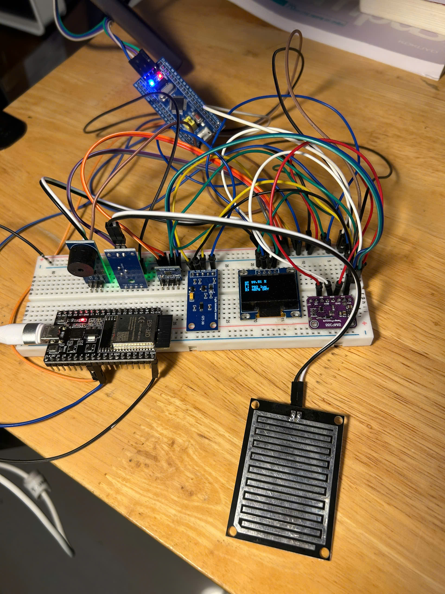
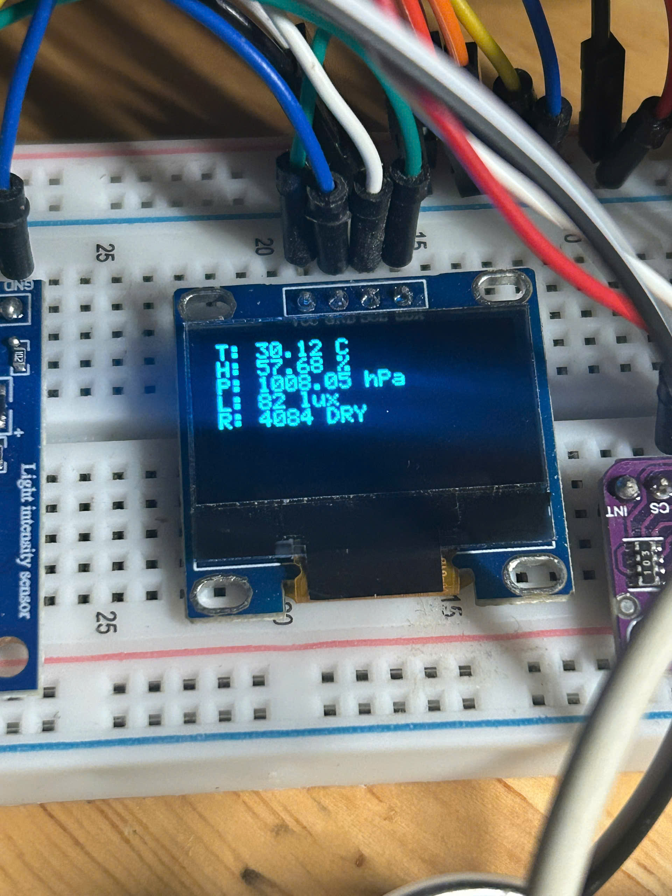
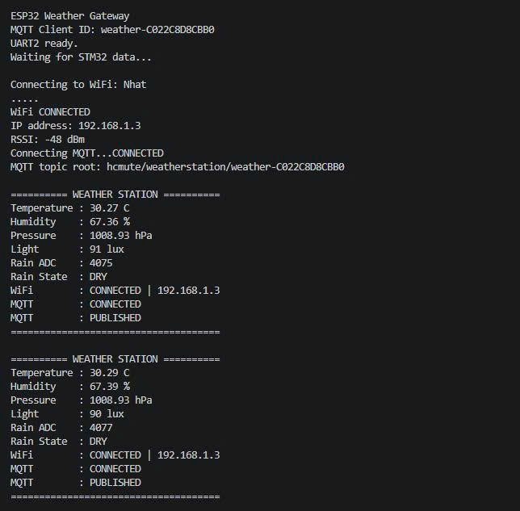

# STM32 IoT Weather Station

An IoT-based weather monitoring system developed using **STM32F103C8T6** as the main embedded controller and **ESP32** as the Wi-Fi/MQTT communication gateway.

The system collects environmental data, displays measurements locally on an OLED, detects rain conditions, activates a buzzer warning, and publishes sensor data through MQTT to a Node-RED dashboard for remote monitoring.

---

## 1. Project Overview

The project is designed as a complete embedded weather monitoring system.

The **STM32F103C8T6** is responsible for:

- Reading environmental sensors.
- Processing measurement data.
- Determining rain conditions.
- Controlling the OLED display.
- Controlling the buzzer.
- Sending weather data to the ESP32 through UART.

The **ESP32** is used as a communication gateway. It receives processed sensor data from the STM32, connects to Wi-Fi, publishes the information to an MQTT broker, and allows the data to be visualized using Node-RED.

System data flow:

```text
SHT30 ─────┐
BMP388 ────┤
BH1750 ────┼────> STM32F103C8T6
Rain Sensor┘              │
                          ├────> OLED
                          ├────> Buzzer
                          │
                          └────> UART
                                   │
                                   v
                                 ESP32
                                   │
                                 Wi-Fi
                                   │
                                   v
                              MQTT / HiveMQ
                                   │
                                   v
                                Node-RED
                                   │
                                   v
                                Dashboard
```

---

## 2. Hardware Prototype

The completed prototype integrates the STM32, ESP32, environmental sensors, rain sensor, OLED display and buzzer.



### Main Hardware

| Component | Function |
|---|---|
| STM32F103C8T6 | Main embedded controller |
| ESP32 DevKit | Wi-Fi and MQTT gateway |
| SHT30 | Temperature and humidity measurement |
| BMP388 | Atmospheric pressure measurement |
| BH1750 / GY-30 | Ambient light measurement |
| Rain Sensor | Rain level detection using ADC |
| OLED Display | Local weather data display |
| Active Buzzer | Rain warning |
| Breadboard | Prototype hardware platform |

---

## 3. Main Features

The implemented system provides the following functions:

- Temperature monitoring.
- Humidity monitoring.
- Atmospheric pressure monitoring.
- Ambient light monitoring.
- Rain sensor ADC measurement.
- Rain classification.
- Local OLED display.
- Buzzer warning.
- STM32-to-ESP32 UART communication.
- Wi-Fi connectivity.
- MQTT data transmission.
- HiveMQ broker communication.
- Node-RED data processing.
- Real-time dashboard.
- Temperature history chart.
- Automatic Wi-Fi reconnection.
- Automatic MQTT reconnection.
- Automatic recovery after power restart.

---

## 4. STM32 Sensor Processing

The STM32 reads data from four environmental sensing modules.

### SHT30

Used to obtain:

```text
Temperature
Humidity
```

### BMP388

Used to obtain:

```text
Atmospheric Pressure
```

### BH1750

Used to obtain:

```text
Light Intensity
```

### Rain Sensor

The analog output of the rain sensor is measured using the STM32 ADC.

Experimental values were approximately:

```text
Dry        ≈ 4000
Low Rain   ≈ 2000
Heavy Rain ≈ 1000
```

The implemented thresholds are:

```text
ADC >= 3000          -> DRY

1500 <= ADC < 3000   -> LOW

ADC < 1500           -> HEAVY
```

---

## 5. Rain Warning

The system classifies the rain condition into three states:

| Rain State | ADC Condition | Buzzer |
|---|---:|---|
| DRY | ADC >= 3000 | OFF |
| LOW | 1500 <= ADC < 3000 | Short warning beep |
| HEAVY | ADC < 1500 | Continuously ON |

This allows the system to provide a local warning without requiring an Internet connection.

---

## 6. Local OLED Display

Weather information is displayed directly on the OLED connected to the STM32.

The OLED shows:

```text
T: Temperature
H: Humidity
P: Pressure
L: Light
R: Rain ADC + Rain State
```

Actual OLED output:



This local interface allows the weather station to continue displaying sensor information even when Wi-Fi or MQTT is unavailable.

---

## 7. STM32 to ESP32 Communication

The STM32 sends processed weather data to the ESP32 through UART.

UART configuration:

```text
Baud Rate : 115200
Data Bits : 8
Parity    : None
Stop Bits : 1
```

The transmitted data contains:

```text
Temperature
Humidity
Pressure
Light
Rain ADC
Rain State
```

The ESP32 continuously receives the weather information and prepares it for MQTT transmission.

---

## 8. ESP32 Wi-Fi and MQTT Gateway

The ESP32 does not perform the main sensor processing.

Its main role is to provide network connectivity for the STM32-based weather station.

The ESP32 performs the following tasks:

1. Receive weather information from STM32 through UART.
2. Connect to the configured Wi-Fi network.
3. Connect to the MQTT broker.
4. Publish weather data to individual MQTT topics.
5. Monitor Wi-Fi and MQTT connection status.
6. Automatically reconnect when communication is lost.

Actual ESP32 Serial Monitor:



The Serial Monitor confirms:

```text
WiFi : CONNECTED
MQTT : CONNECTED
MQTT : PUBLISHED
```

along with the received environmental measurements.

---

## 9. MQTT Communication

The project uses the public HiveMQ MQTT broker:

```text
broker.hivemq.com
```

The main topic structure is:

```text
hcmute/weatherstation/weather-<DEVICE_ID>/
```

Sensor information is published through topics such as:

```text
temperature
humidity
pressure
light
rain/raw
rain/state
status
```

Example:

```text
hcmute/weatherstation/weather-<DEVICE_ID>/temperature

hcmute/weatherstation/weather-<DEVICE_ID>/humidity

hcmute/weatherstation/weather-<DEVICE_ID>/pressure

hcmute/weatherstation/weather-<DEVICE_ID>/light

hcmute/weatherstation/weather-<DEVICE_ID>/rain/raw

hcmute/weatherstation/weather-<DEVICE_ID>/rain/state

hcmute/weatherstation